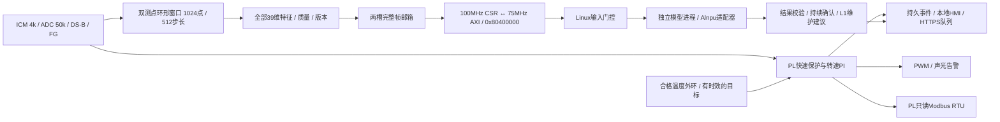

# 完整测控链路：EDG1 / FRM1 v1

> **2026-10-23 当前功能边界修正：取消自动断电。** 不再提供风机供电使能、热负载降额/停机执行器、执行回执或 LOAD_STATUS 命令。保留 PWM 调速/限幅/禁止、独立硬保护、锁存、声光/RS485/网站告警及人工处置提示。J12-22/W8 改为高阻备用，弱下拉。PWM=0 不等于停转，更不等于断电。健康基线自适应不能覆盖保护、清锁存或学习故障为正常。最新候选和验证状态见 `46_取消断电逻辑与清理验收_2026-10-23.md`；旧交付包与板上固件不会自动改变。

> 2026-10-13：新增Linux配套 `linux/hmi_daily/`，包含本地日常数据屏与健康工况基线观察版。复用本FRM1/保护合同，无新增RTL/位流或保护放行。应用是唯一邮箱消费者，不能与正式 `run_edge.py --live` 同时争用UIO；当前尚无合格真实39维，基线学习默认拒绝。实现及验收边界见 [日常显示与基线README](linux/hmi_daily/README.md)。

> 2026-10-10复审：CSR独立复位隔离与邮箱半帧中止已修复。CSR目标域复位返回FF传输错误，不自动重放已发出操作；详见[复审记录](../../review/review_20261010.md)。当前完整构建是r4，旧r3 HDMI时序不通过。

> 2026-10-09收口更新：39维特征缓存/频带共享累加、WAV1与PS完整链路已接入；本轮仿真和独立综合、完整TEST/REAL位流状态分开验收，见 [FPGA交付记录](FPGA_DELIVERY_20261009.md)。下文旧未接入/资源数据按其日期理解。


更新：2026-10-08。源工程：`D:\Desktop\FU_Code\soc_merge\soc_merge`。

本目录把原来的采集、39维特征、FCB1控制与PS服务接成一条可用模拟数据验证的链路。已包含重叠窗口、过程量聚合、AXI地址扩展/跨域、完整帧邮箱、Linux接收、推理适配、策略融合、持久事件、上报重试、本地HMI和只读RS485。真实标定、NPU模型资格、最终整机时序及实板结果单独验收。

**默认配置不授予自动控制或正式模型诊断资格。旧SD卡和旧位流不会因源码更新而包含这条链路。** 最新验证入口为 `sim/results/validation.json`、`sim/td_feature_final/validation.json` 和 `sim/td_link_final/validation.json`；`RUNNING` 或 `NOT_ACCEPTED` 都不表示可发布位流。

## 1. 数据及动作路径



快速保护不等待窗口、Linux、模型或网络。模型没有直接控制PWM、消音、复位保护的入口。网站ACK仅标记“已查看”。没有热负载执行器或供电控制。

## 2. 工程入口和模块

| 工程/入口 | 选择 | 用途及边界 |
|---|---|---|
| `cooling_link.al` / `cooling_link_top` | CAMERA=0，FEATURES=1，TEST=0 | 实际传感器链；保留HDMI/NPU，BENCH关闭。复位和未配置时禁止PWM与风机供电；需按本地许可流程提交合格配置 |
| `cooling_link_test.al` / `cooling_link_test_top` | CAMERA=0，FEATURES=1，TEST=1 | FPGA生成4k振动/50k过程测试源；真实风扇PWM抑制，测试源不送快速保护输入 |
| `edge_eval.al` / `edge_eval_top` | 独立特征路径 | 100MHz局部综合评估；综合器会优化相关测试波形，资源不能当作真实传感器整机增量 |
| 原 `soc_prj.al` / `system_top` | 默认CAMERA=1，FEATURES=0 | 历史合并入口；不能用它来声称完整39维已启动 |

`rtl/edge_window.v`负责两组三轴2048点环形RAM、独立序号/时间、50%重叠、轴优先读出及覆盖检测。`edge_window_mean.v`聚合两半窗口的ADC和FG均值。`edge_features.v`连接过程换算及原有特征核；`edge_mailbox.v`保存不可变完整帧。`edge_csr_cdc.v`用整组请求/应答握手跨域，`edge_axil_router.v`接PS GP0转换器，新页以外沿原矩阵路由。`edge_rs485.v`提供只读遥测。

六轴仍串行复用一个FFT。每帧每轴1024个新样本，A的x/y/z后接B的x/y/z；35个振动相关量加4个过程量全部在PL完成。FP32输出使用有界的串行Q16转换，等待期间原始采集继续进行。

双ICM初始化已改为 `PWR_MGMT_2(0x6C)=0x07`、`I2C_IF(0x70)=0x40`，并逐片回读配置。仿真模型现处理这些寄存器及忽略写入故障。寄存器定义依据 [TDK ICM-20602数据手册](https://product.tdk.com/system/files/dam/doc/product/sensor/mortion-inertial/imu/data_sheet/ds-000176-icm-20602-v1.1.pdf)，真实新样本率仍需实测。

## 3. 地址、完整帧和配置合同

PS物理页：`0x80400000..0x8040FFFF`，32位小端、4字节对齐。`0x0000..0x07FF`沿用FCB1控制寄存器，见 `../control/README.md`。

| 偏移 | 访问 | 含义 |
|---|---|---|
| 1000 / 1004 | R | EDG1=`45444731` / ABI=`00010000` |
| 1008 | R | bit1:0完整帧数，bit3正在建帧，bit4特征引擎忙 |
| 100C | R | 邮箱满而丢弃的新帧累计数 |
| 1010 | R/W | 队首frame_id；写精确匹配ID才ACK，重复上次ACK幂等 |
| 1020 / 1024 | R | 活动feature_config_id / calibration_id |
| 1040 | R/W | 暂存17字写入掩码 / 提交常数`45434D54` |
| 1050 | R/W | PL本次启动cookie；零表示尚未登记，非零只允许写一次或重复同值，PL复位归零 |
| 1100..117C | R | 32字FRM1帧头 |
| 1200..1298 | R | 固定顺序的39个IEEE binary32特征 |
| 1300..1340 | R/W | 特征配置17字暂存 |
| 1380..13C0 | R | 特征配置17字活动值 |

两槽邮箱只提交完整帧，PS读取期间不会覆盖队首。满时丢新帧并记数，不回压采集；PS校验并释放坏帧，同时记录拒绝原因。一个进程消费邮箱和管理FCB1命令，禁止第二个消费者。

帧头32字（每字uint32；64位时间低字在前）：

| 字号 | 定义 |
|---|---|
| 0..4 | FRM1=`46524D31`，ABI=`00010000`，长度284B，frame_id，窗口结束uptime_ms |
| 5..8 | 窗口开始/结束64位采集时钟计数 |
| 9..12 | A/B首末样本间隔时钟数，A/B有效点数（均1024） |
| 13..15 | ADC计数、FG计数、质量 |
| 16..19 | 特征配置ID、标定ID、采样模式ID、窗口开始控制模式 |
| 20..22 | 名义振动Fs=4000、实际采集CLK_HZ、ADC名义Fs=50000 |
| 23..25 | 窗口丢失计数、DS-B快照年龄ms、A/B末端对齐误差时钟数 |
| 26..28 | 源码构建标签`202610A0`、编译期TEST标记、A/B序号摘要 |
| 29..31 | 电流/压差原始均值Q16.16、FG平均周期（时钟数） |

构建标签是ABI标签；交付包另有SHA256清单，不把标签当作位流文件哈希。

39项顺序：A三轴rms(0..2)、pp(3..5)、kurt(6..8)、banda0..7(9..16)；B三轴rms(17..19)、pp(20..22)、kurt(23..25)、bandb0..7(26..33)；ratio_ab(34)、current/A(35)、temp/℃(36)、pressure/kPa(37)、rpm(38)。16个频带使用FFT，其余23项按时域、比值及过程量计算。频带为三轴功率求和后归一化；具体数学定义见 `../features/README.md`。

| 质量位 | 含义 |
|---|---|
| 0..3 | 零方差、非法频带、振动轨限/饱和、数值溢出 |
| 4..7 | A缺样、B缺样、A采样率异常、B采样率/对齐异常 |
| 8..11 | 电流、DS-B温度、压差、FG无效 |
| 12..14 | 未标定、窗口包含非RUN/模式变化、编译期测试源 |
| 15及以上 | 保留，软件拒绝未知位 |

读出覆盖会中止整帧；不会补零/重复旧样本冒充新数据。50%重叠并不使A/B两个独立晶振天然同步，帧内实测Fs和对齐误差必须合格。DS-B使用截至窗口末最近有效转换，不把同一次温度读数当多次独立观测。一次短暂调速后恢复RUN，整窗仍带暂态位。

配置17字：特征ID、标定ID、qualified布尔、current_zero_Q16、pressure_zero_Q16、current_gain_Q30、pressure_gain_Q30、PPR、9个频带bin边界。边界严格递增，从1到513，区间左闭右开；DC不入频带，Nyquist在末带。每次改变口径使用新ID，在本地维护许可且引擎空闲时原子提交并回读；旧排队帧保留旧ID，软件按合同拒绝。FCB1控制PPR与此PPR分别配置，必须同一实测依据。

## 4. Linux、模型、报警和网络

`linux/`可独立交给Linux同学。标准库路径已移除 dataclasses、Python 3.7 的 subprocess 简写和 ThreadingHTTPServer 依赖，按 Python 3.6 语法/API 兼容；本轮主机测试不替代板上 Python 3.6 运行验收。MMIO访问的小C库需在目标Linux编译；NPU适配器需要C++17编译器和板卡原ArmNN/Alnpu库。UART维护需要pyserial。ONNX选项是CPU推理，明确显示 `CPU_ONNX`，外部运行时按板上环境单独验收。

2026-10-14 整合：`run_edge.py --local-display --no-http` 是显示、学习、推理、日志/上报的唯一硬件采集入口；有界订阅线程运行学习及显示发布，不打开 UIO、不 ACK 帧，也不阻塞硬件线程。`hmi_daily/run_live.py` 默认仅启动只读 LVGL 前端，不再另起采集器；只有明确的 `--managed-collector` 开发模式才管理同一整合后端。正式部署使用配套两个 systemd 单元，先停止旧独立采集服务，不能取消独占锁让两个接收器抢帧。详见项目 26 收口交付文档。

- 帧门控检查长度、FP32有限值、帧序/回绕、配置与标定ID、RUN/暂态/TEST、新鲜度、1024点、Fs与A/B对齐、过程计数和温度年龄。所有配置参数必须与训练口径一致。
- `npu_server.py`常驻加载模型；`npu/edge_npu.cpp`使用本地板卡SDK的ArmNN/Alnpu，只请求Alnpu后端，无CPU兜底。检查39入/5出、FP32或逐张量8bit量化，使用SDK的CMA缓冲同步。**已通过实际SDK头文件的语法编译；ARM链接、算子支持、硬件执行仍未验收。**
- 模型命令/socket接口有期限；结果必须回显frame_id、model_id、feature_config_id、calibration_id及5个合法概率。NPU超时锁定不可用，不在不清楚DMA状态时自动重载。需人工检查/复位驱动后重启。
- 正式模型异常持续确认后只产生L1维护建议；未合格/TEST/低置信度只观察。输入无效、推理间隔超过配置期限或PL重启会重置确认，旧工作结果不得跨越这些变化生效。物理L2/L3及实际动作始终优先。
- 采集、模型、SQLite、负载执行、上报在独立工作线程。模型队列2帧，拥塞丢旧帧并计数；日志队列256，关键PL FIFO先持久化再POP。数据库失败时保留PL队首重试，PL控制继续运行。
- 事件保留原因、当前/峰值级别、ACK、配置/模型/标定/帧上下文、请求与实际回执。PL FIFO每次状态变化同时形成幂等历史事件 `PL_TRANSITION / RECORDED`，保留两次轮询间短故障；当前每个原因的ACTIVE/RECOVERED仍由新鲜状态维护。两类记录用途不同，平台不可将历史快照当当前动作。
- SQLite journal与outbox原子提交；优先发送高峰值级别，断网重试。POST后只有匹配event_id与event_revision的明确回执才删除队列。HTTPS校验证书，设备token取环境变量。默认URL为空，不向外部平台发送数据。
- 本地HMI一秒刷新；服务不可达会清空实时值，设备断线/模型过期显示未知。未标定过程量标为名义值。网页无SET_TARGET、STOP、RESET、SILENCE入口；ACK不改变保护、声音或PWM。

温度外环已实现有界RPM PI、斜率限制、抗饱和及健康门控，但默认关闭，系数留空。控制所有权、外环、负载执行器分别需要合格配置及证据。执行器无接口时显示 `UNSUPPORTED / LOAD_UNCONFIRMED`，不会捏造停机回执，也不因请求恢复NONE自动重启负载。

## 5. 现在可以运行的联调

电脑端（命令在`src/edge/linux`内运行）：

```powershell
py -3 run_edge.py --mock --collector
# 浏览器 http://127.0.0.1:8766；Ctrl+C结束
```

也可双击 `linux/start_mock.cmd`。模拟输入经过39维帧解析、模型接口、融合、事件/HMI/本地接收端；始终带测试标记，不打开硬件。独立RTL生成且已与NumPy对拍的帧可回放：

```powershell
py -3 run_edge.py --mock --collector --replay ..\sim\results\frames.hex
```

验证本地送达：复制配置另存，设置uplink URL为 `http://127.0.0.1:8766/v1/devices/events`、`loopback_test=true`，用 `--config`启动。生产平台需提供自己的HTTPS接口/身份、收件及通知策略，不能把这个本地测试收件端当已上线网站。

完整回归（需NumPy、Icarus）：

```powershell
python src/edge/tools/run_regression.py
python src/features/tools/run_regression.py
```

在板端Linux：先确定实际UIO地址，编译 `make -C native`，正确合并 `dts/cabinet-uio.dtsi`至板卡DTB并重启，然后只读联调。**dtsi不是SD启动镜像，应用zip不是BOOT.bin。** `install.sh`仅安装服务，默认不启动/不enable，不自动修改DTB。

```sh
sudo ./install.sh
python3 /opt/cabinet/linux/link_cli.py --config /etc/cabinet/edge.json --live status
# TEST FPGA位流配合明确诊断模式，不取得执行器控制权
python3 /opt/cabinet/linux/run_edge.py --config /etc/cabinet/edge.json --live --diagnostic-test
```

先检查 `FCB1/EDG1` magic、ABI、cookie、实时帧计数及TEST质量，核对32位寄存器读写；不要把PS启动日志串口当PL FCB1串口。配置拒绝在MMIO上可能转为ARM总线异常，首次配置建议PL UART维护通路。

配置工具默认dry-run，不打开设备：

```sh
python3 link_cli.py feature-config feature_config.example.json
python3 link_cli.py --config /etc/cabinet/edge.json --live feature-config feature_config.example.json
python3 link_cli.py --config /etc/cabinet/edge.json --live control-config <实测后的FCB1配置.json>
```

实际修改前停止cabinet-edge，取得本地维护许可。特征模板是未标定示例，不给保护授权。合格后核对控制和特征两套活动ID、PPR、ADC零点和工程量单位，更新软件合同；先用本地工具给有效初始目标，再由合格服务持续刷新。外环不会从READY_OFF自动启动风扇。

## 6. RS485合同

Modbus RTU地址1、115200/8N1、CRC16，支持功能03且一次最多16寄存器；DE有前后保护间隔。其余功能返回对应异常功能码，不允许写控制或远程复位。收帧后快照各字段，避免一次回复内撕裂。

0/1=active低/高16位；2/3=latched；4=模式/动作摘要；5=PWM计数；6=RPM；7=DS-B有符号1/16℃；8/9=电流原始码幅值；10/11=控制配置ID；12=事件序号低16位；13=丢事件低16位；14=UART坏帧低16位；15=串口忙丢帧低16位。不是完整事件传输通道，16位计数需接受回绕。

## 7. 构建、生成文件和发布门槛

`tools/integrate.py`保留可重复应用的SystemBuilder生成HDL扩展钩子。`design_0/Design.xml`及`address.xml`是原厂GUI工程元数据，尚不表达此手写router；实际连接以 `design_0/hdl/design_0.v`、活动工程和 `design_0/edge_address.json` 为准。**重新点击SystemBuilder生成会覆盖手写扩展，须重新应用钩子并重跑验证；不能让GUI自动生成的旧地址表与新HDL混用。**

用隔离目录构建，保持旧位流不动：

```powershell
python src/edge/tools/build_td.py --output src/edge/sim/td_link_release --end opt_route --timeout 7200
```

新增CSR链以100MHz运行，经握手连接75MHz PS AXI。现有HDMI/NPU/VTG时钟保留原配置，本轮没有将显示改为720p，也不证明旧LVGL启动异常已修复。异步时钟分组只用于真正有CDC的边界，不放宽同域Setup/Hold。

发布必须有同一源码/工程/约束哈希对应的整机资源、Setup、Hold、时钟与约束覆盖、位流，以及板端显示/NPU/传感器/动作回归。局部特征100MHz gate通过不能替代整机通过。若全芯片报告不通过，保留完整源码和模拟交付，不烧录其生成物。

## 8. 未验收项

1. 真机PPR、PWM/FG电气与失电行为、电流/压差/温度/PI/回退标定、负载执行回执及声光。
2. A/B真实4k新样本率、跨测点对齐/频漂、AD7606 50k与DS年龄、连续采集及实际窗口吞吐。
3. ARM MMIO库及DTB、板端39维对拍、PL复位/PS重启、磁盘满/掉电、现场RS485。
4. 原厂Alnpu SDK的ARM链接/算子支持/量化模型、真实39维训练及误报/漏报/时延。
5. 正式网站部署、设备身份、通知/权限、存储容量/保留与离线事件压力；本地收件端只做开发验证。
6. 采集时钟真正停止时CSR握手无法完成，需要平台总线看门狗/硬件独立失效措施；软件超时不能让停止的PL时钟继续执行保护。
7. UART与PS同时写配置/命令没有跨会话所有者锁，须由维护流程保持唯一写者；MMIO库只保护同一个Linux设备文件的进程独占。
8. 真机模型工况范围、干净滤网RPM基线、独立未知工况拒识及模型更新回退仍依赖实际合同/数据。当前低置信度和质量门控不能替代分布外检测。


## 9. 本轮最终硬件评估结论

完整 `cooling_link_top` 综合已完成，但布局失败：gate估算57652/52480 slices（109.86%），189 ERAM、154 DSP；TD实际布局报SLICEL超限并以PHY-9002停止。因此没有新布线Hold或发布位流。不能把gate估计直接当最终布局资源，但此次容量不足有布局失败的直接证据。

随后修复了无效PS原生时钟名称导致整个异步时钟分组失效的问题，并对同一gate网表重新分析：分组生效，新100MHz采集/特征同域Setup +0.436ns；整机仍为−2.903ns，最差是已有NPU resize。PS硬宏GEN_PL_GP0S/GP1S/HP0/HP1仍有未覆盖告警，VTG频率148.485/148.500MHz差异仍在。见`sim/clock_recheck/validation.json`，该检查只重分析约束，不是新综合或P&R。

GP0新增线网声明已移到实例前，最终顶层另做TD elaboration检查；不因声明清理而冒用旧网表哈希。下一项硬件工作是基于实际39维模型确认所需NPU算子/视频功能，做资源削减或运算单元共享，再重新生成PS硬宏时钟配置并跑整机P&R。不能通过降低约束而不改硬件，或全域false_path来宣布通过。
